# Excellent Improved Particle Swarm Optimization (PSO) Algorithm (Matlab Code Implementation)

​  
This article's table of contents is as follows: ⛳️⛳️⛳️ Table of Contents 1. Overview 1.1 Intelligent Optimization Algorithms 1.2 Particle Swarm Optimization Algorithms 2. Particle Swarm Algorithms 2.1 Concepts 2.1.1 Concept of Particle Swarm Optimization Algorithms 2.1.2 Updating Rules 2.1.3 Penalty Terms 2.2 Program Flowchart 2.2.1 Pseudo Code 2.2.2 Program Flowchart 3 Matlab Simulation Results 3.1 Single-Objective Case Testing 3.2 Multi-Objective Case Testing 4 Matlab Code 5 Final Thoughts
1.2 Particle Swarm Optimization Algorithm
2 Particle Swarm Algorithm
2.1 Concept 2.1.1 Particle Swarm Optimization Algorithm Thought Particle Swarm Optimization (PSO: Particle Swarm Optimization) is an evolutionary computing technique. Originating from research on the behavior of bird flocks. The basic idea of Particle Swarm Optimization Algorithm: It seeks the optimal solution by collaboration and information sharing among individuals in a group. The advantage of PSO lies in its simplicity, ease of implementation, and lack of many parameter tunings. It has been widely applied in the fields of function optimization, neural network training, fuzzy system control, and other areas of genetic algorithm applications. The idea of the Particle Swarm Algorithm originates from the process of birds hunting in real life. Assume in a n-dimensional space, there are m birds (m) foraging. The food is located at some point in the n-dimensional space. For each of the i-th bird at a certain moment, there are two vectors describing it: one is the bird's position vector, and the other is the bird's velocity. Assume that birds can judge the quality of a location, which is defined as whether it's closer to food or further away. Birds adjust their speed based on their own experience and the positions of other birds in the flock during foraging. By determining their current position and speed, they can predict where they will be next. This allows each bird to continuously update its speed and position through learning from both itself and the flock, ultimately finding food or a sufficiently close point to it. Particle swarm is a classic adaptive algorithm, similar to bat algorithms, cuckoo search algorithms, and bee colony algorithms. The movement of a particle will reference both the historical best and the current best. By setting c1 and c2 to represent their importance, each particle's speed differs. The speed is also influenced by w. Together, these three factors determine the next position that the particle will reach. 2.1.2 Update rules PSO initialized as a population of random particles (random solutions). Then find the optimal solution through iteration. In each iteration, particles update themselves by following two "extreme values" (pbest, gbest). After finding these two optimal values, the particles update their own velocities and positions according to the following formula. Edit it to: f is the average of the current fitness function; V is the particle velocity; X is the particle position; rand() generates a random number between 0 and 1. c1 and c2 are learning factors, typically set to c1=c2=2. Best is the current optimal solution. bestx is the historically optimal solution. The first part of the formula (1) is called the "memory term", which represents the impact of the previous speed magnitude and direction. The second part of formula (1) is referred to as the "Self-Cognition Item," which is a vector from the current point to the particle's best position, representing the part of the particle's action originating from its own experience. The third part of formula (1) is referred to as the "Group Cognition Item," which is a vector from the current point to the best point in the population, reflecting the synergy and knowledge sharing among particles. Particles determine their next movement based on their own experiences and the best experiences of their peers. Based on the above two formulas, the standard form of PSO is formed.
Edits formula (2) and formula (3) are considered as standard PSO algorithm 2.1.3 Penalty term Its thought is similar to the interior-point method in linear programming, which forces the model to always seek optimization within the feasible domain through the addition of a penalty function during iterative calculations. In the Particle Swarm Optimization algorithm, each iteration updates both Pbest and Gbest. Although constrained problems can be converted into unconstrained ones for iterative solution, the solutions xi still exist cases where they do not meet the constraints. Therefore, some rules are needed to compare the quality of two particles. The rules are as follows: 1. If both particle xi and xj are feasible, then compare their fitness function f(xi) and f(xj), and the particle with smaller value is considered superior. 2. When both particles xi and xj are infeasible, compare the penalty terms P(xi) and P(xj), and select the particle with less violation of the constraint as superior. 3. When particle xi is feasible and particle xj is not, select the feasible solution. The upper and lower bound constraints for particles can be reflected in the position update function, without the need for penalty terms. The specific approach involves iterating through each particle's position, and if the position exceeds the upper or lower limit, it is changed to either of the two positions within the range. 2.2 Program flowchart
2.2.1 Pseudocode Editing 2.2.2 Program Flow Diagram Editing
Editor
3.2 Multi-objective Example Test
Editor
Editor
Editor
Editor
4. Matlab Code
Editor
5. Endnotes: The references to theoretical literature are from online sources, and if any infringement is found, please contact the blogger for removal.
​  

## Images

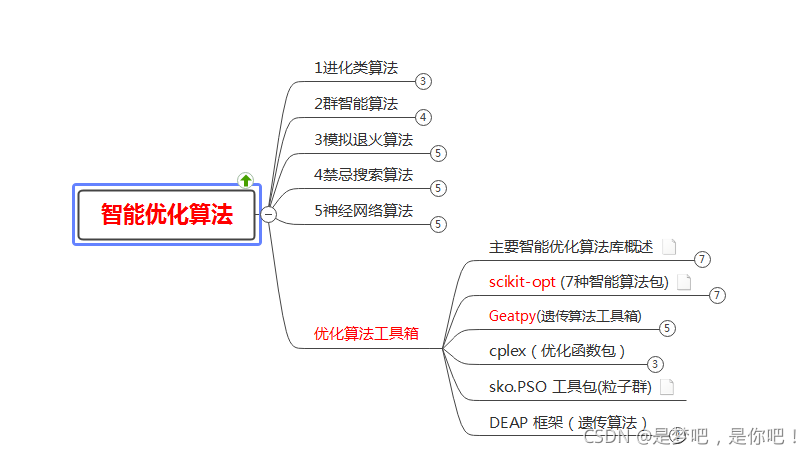
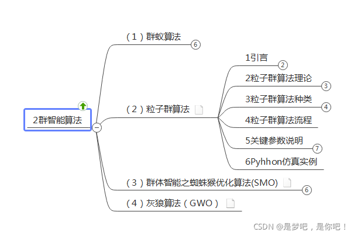
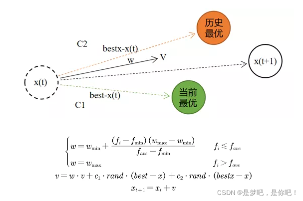
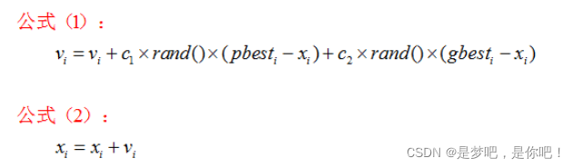
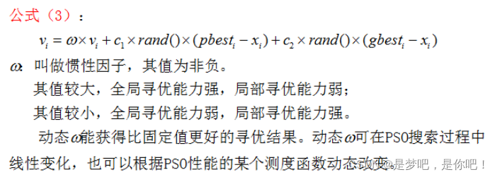
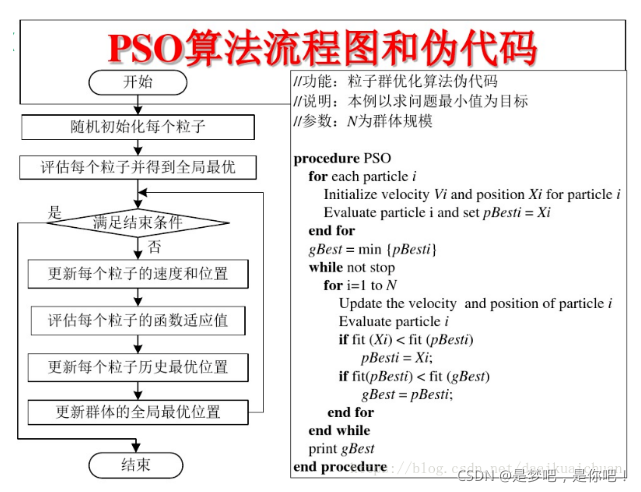
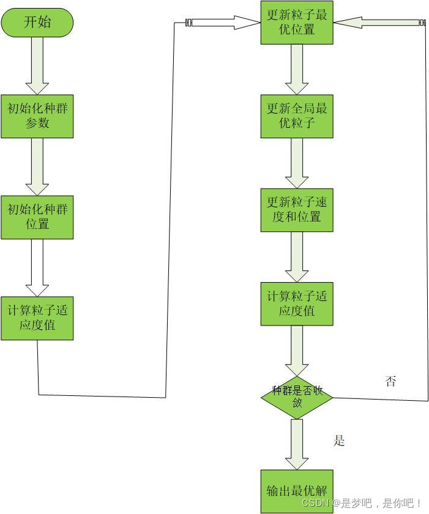
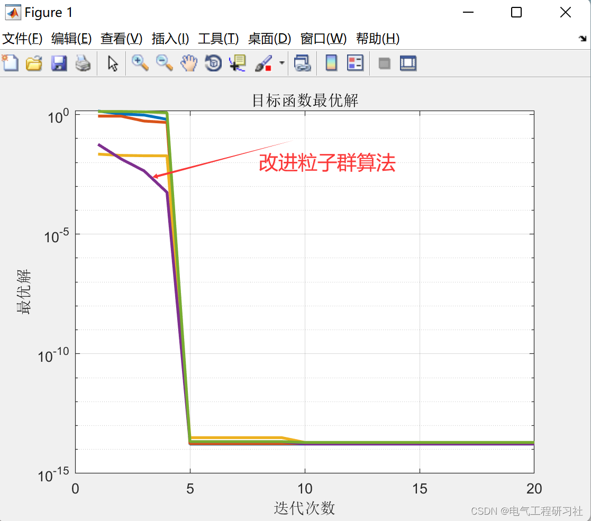
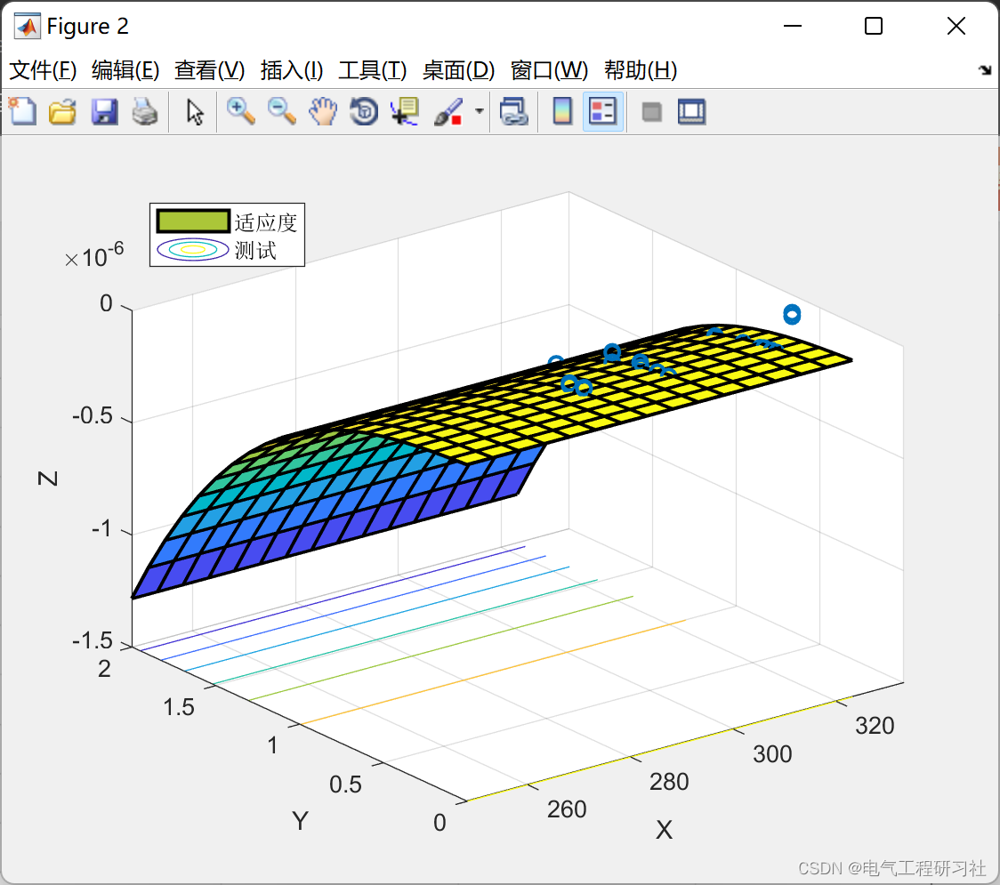
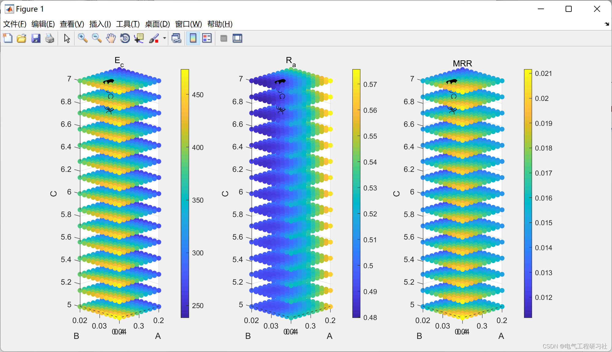
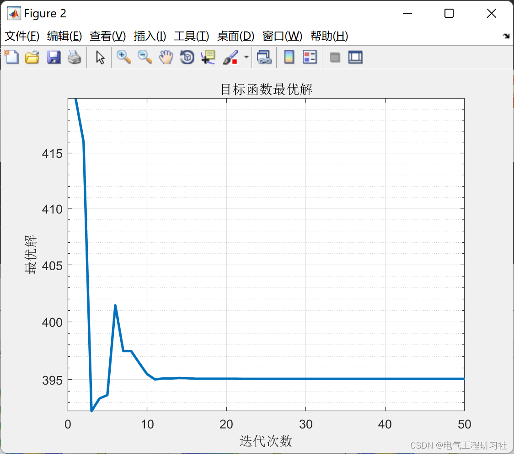
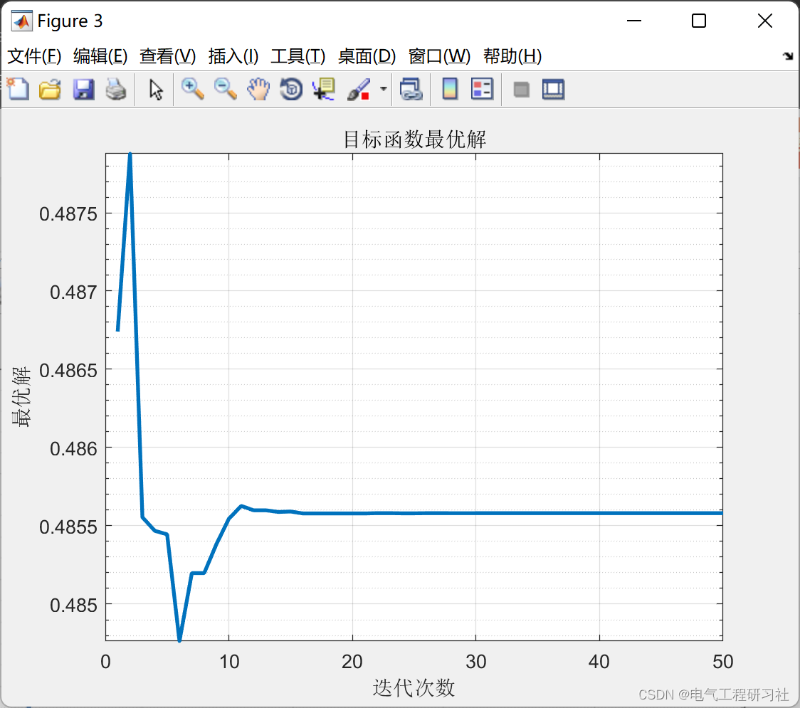
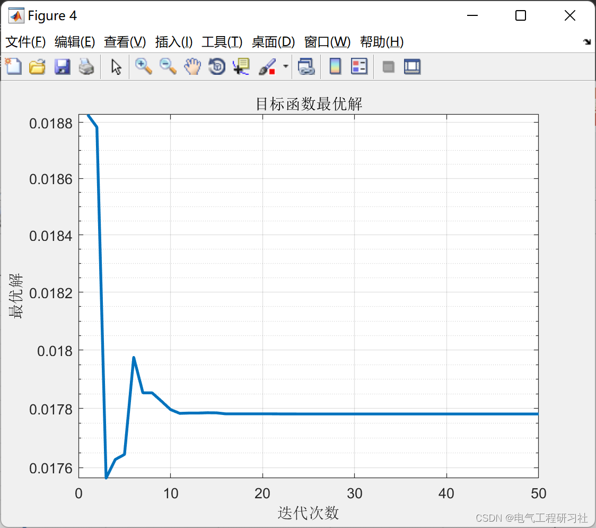

<!-- PAYMENT_BLOCK -->

## Get this dataset

- Payment link (Stripe): [Buy now](https://buy.stripe.com/3cs8yP7sY87d0vu9AB)
- Payment QR code: 

<!-- /PAYMENT_BLOCK -->
